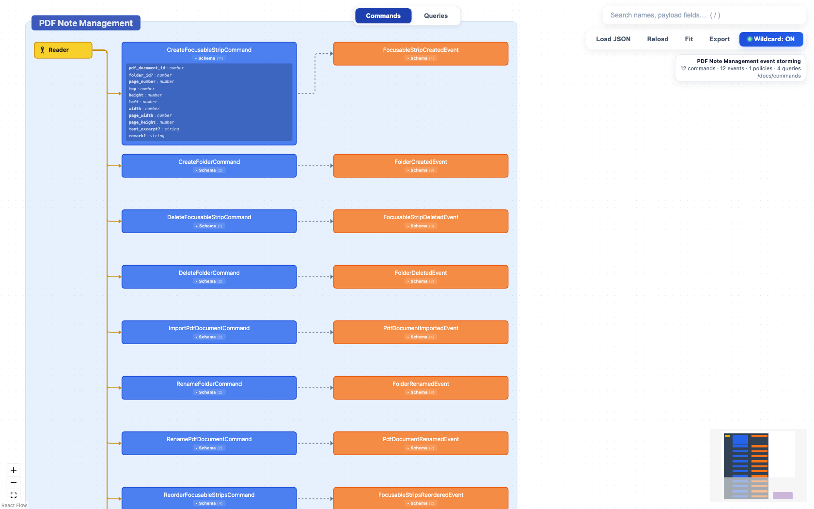

# event-storming

The event-storming diagram of [`@machingclee/express-cqrs`](../README.md): a Vite
app at the root of the package repository. Its build lands in
`../src/event-storming/public`, which the package serves at `/event-storming`, and
the page reads the live graph from `GET /docs/commands` on its own origin — no
copy of the JSON, no proxy in production, no drift between diagram and code.



## Build and open it

```bash
# 1. build the diagram into the package's served folder
cd event-storming
npm install
npm run build          # vite writes ../src/event-storming/public

# 2. copy it into dist/, which is what an installed package serves
cd .. && npm run build

# 3. in a host app running the package
bun run dev                                  # http://127.0.0.1:4317
open http://127.0.0.1:4317/event-storming    # the page
open http://127.0.0.1:4317/api-docs          # Swagger UI → domain → GET /docs/command-flow
```

From the repository root, `npm run build:event-storming` is step 1 on its own.

`GET /docs/command-flow` is the documented way in: a browser is redirected to the
page, other clients get `{ page, pageUrl, flow, built }`. The Swagger UI also
renders it as a clickable link (the banner at the top, and the operation's
*External Docs*), so the page is one click from `/api-docs`.

`npm run build` has no separate "copy to the package" step: `build.outDir` in
[`vite.config.ts`](vite.config.ts) points at `../src/event-storming/public`, the
folder [`src/event-storming/assets.ts`](../src/event-storming/assets.ts) mounts at
`/event-storming`. The repository's own `npm run build` copies it into
`dist/event-storming/public` for consumers.

### Development

```bash
# in the host app that installed the package
bun run dev                              # the data source, :4317

# here, in the diagram app
npm run dev                              # the UI with HMR, :5183
```

In dev the page is served at `http://localhost:5183/` and `/docs/*` is proxied to
the backend, so the app calls exactly the same path in both modes. Nothing else
is needed: no CORS (the request is same-origin in production, server-side in
dev), no sample file.

### If the backend has a launch token

With `BACKEND_TOKEN=…` the backend protects `GET /docs/commands` too. The page
then shows a token prompt, sends it as `X-Backend-Token`, and remembers it in
`localStorage` for the next visit. The API is deliberately *not* opened up: only
the static diagram is served before the check, mirroring how the Swagger UI is
mounted.

```bash
BACKEND_TOKEN=devsecret bun run dev       # then paste devsecret in the page
```

## The JSON it draws

The page asks its own backend for `/docs/commands` and accepts either shape,
detected automatically:

### 1. `CqrsFlow` — what this repository's backend returns

Built from decorators at boot (`@machingclee/express-cqrs` (`CqrsFlow`)). Every
command, query and event carries a `payload` (`field: type`), and `dtos` holds the
nested shapes those payload types name — that is what the cards' `▸ Schema (n)`
chips show.

```json
{
  "commands": [
    {
      "name": "RenameFolderCommand",
      "handler": "RenameFolderCommandHandler",
      "context": "PdfNoteManagement",
      "actors": ["Reader"],
      "transaction": "required",
      "emits": ["FolderRenamed"],
      "payload": { "id": "number", "name": "string" }
    }
  ],
  "queries": [
    {
      "name": "ListFocusableStripsQuery",
      "handler": "…",
      "context": "PdfNoteManagement",
      "actors": ["Reader"],
      "payload": { "filter": "FocusableStripFilter" }
    }
  ],
  "policies": [
    {
      "name": "OrderPolicy",
      "listensTo": ["OrderCancelledEvent", "OrderPlacedEvent"],
      "sends": ["NotifyCustomerCommand", "RefundCommand"],
      "listeners": [
        {
          "event": "OrderPlacedEvent",
          "sends": ["NotifyCustomerCommand"],
          "rules": ["Every accepted order tells the customer."]
        },
        {
          "event": "OrderCancelledEvent",
          "sends": ["RefundCommand"],
          "rules": ["A cancelled order refunds the captured payment."]
        }
      ]
    }
  ],
  "events": [
    {
      "name": "FolderRenamed",
      "context": "PdfNoteManagement",
      "payload": { "folderId": "number", "documentId": "number", "name": "string" }
    }
  ],
  "invariants": [{ "component": "SomePolicy", "method": "on", "rules": ["…"] }],
  "dtos": { "FocusableStripFilter": { "pdfDocumentId?": "number", "unfiled?": "boolean" } }
}
```

### 2. Java-style command flow (the `commandInvoker` / echarge payload)

Commands with payload schemas, an event list per command, a policy map with
invariants, and a DTO map. Cards gain payload rows; policies gain rule text.

```json
{
  "commands": [
    {
      "from": { "command": "AddScheduledCarCommand", "payload": { "bookingScheduleId": "number" } },
      "to": [{ "event": "BookingScheduledCarAddedEvent", "payload": { "bookingVehicle": "BookingScheduledCar.DTO" } }],
      "context": "Booking.Timeslot",
      "actors": ["Admin"],
      "summary": "Add one vehicle into a schedule"
    }
  ],
  "policies": {
    "BookingPolicy": {
      "flows": [{ "fromEvent": "BookingScheduledCarAddedEvent", "toCommand": "ReserveCarCommand", "invariant": "…" }]
    }
  },
  "queries": [],
  "dtos": { "BookingScheduledCar": { "id": "number", "name": "string" } }
}
```

Accepted details:

| Input | Behaviour |
| --- | --- |
| `{ "result": { … } }` or `{ "data": { … } }` | unwrapped before normalization |
| event a command emits but the payload never lists | still drawn, using the emitting command's context |
| event no command emits | drawn as an **external event** in its declared context (`External` when it declares none) |
| command `postCommitEmits` | a clock on that command → event edge: the handler dispatches the event after the commit. The event card gets a `Transactional` badge only when every handler that emits it defers, so a mixed event never claims one timing |
| policy `listensTo: ["DomainEvent"]` | a wildcard listener; its edges sit behind the *wildcard listeners* switch |
| policy `listeners` | one entry per `@EventListener` method; pairs the event with the commands that reaction sends, so the card can show — and the arrows can hit — the real routing. Without it the card tags every rule with `listensTo[0]` / `sends[0]` |
| no policies at all | the policy column and its edges simply are not drawn (this backend excludes its development event log via `@Policy({ excludeFromFlow: true })`) |
| dotted contexts (`Booking.Timeslot`) | one band per context, header shows the dotted path |
| `payload` on a command/query/event | the card's `▸ Schema (n)` chip; click it to open the rows |
| `payload` + `dtos` | nested types open one level (`field: Type { … }`) |
| optional fields | written `field?: type`, exactly as TypeScript would |

A captured response can still be inspected without a backend: **Load JSON** takes
a file, a pasted payload or an explicit URL. That is a side door for comparing
environments — the app never boots from a file.

## Style

The visual system is the one from `echarge-event-storming-component`, not an
approximation of it:

| Piece | Where it comes from |
| --- | --- |
| stylesheet | that project's `index.css`, copied verbatim into `src/index.css` (only the three `@tailwind` directives are dropped — this project has no Tailwind build, and the reference uses no utility classes beyond one `w-screen h-screen`, replaced by `.flow-app`) |
| bounds, action buttons, search box | the same `.flow-toolbar`, `.flow-btn`, `.flow-search-input` classes that stylesheet defines |
| sticky notes | `components/nodes/LabelNode.tsx` ported: centred label, optional summary, HTTP row, collapsible `▸ Schema (n)` block with 11px monospace lines |
| policies | `components/nodes/PolicyNode.tsx` ported: name, `Invariants`, numbered rules with event → command tags, colours from `--policy-bg` / `--policy-border`, and a handle per rule (`flow/policy.ts`) so each arrow enters at the rule that names it |
| context boxes | `components/nodes/GroupNode.tsx` ported, down to the `pointerEvents` trick and the `top: -18px` badge |
| card colours, widths, padding, font size | `flow/theme.ts`, a mirror of that project's `constants.ts` and its layout's style objects (`rgba(37,99,235,0.8)` commands, `rgba(249,115,22,0.8)` events, `rgba(250,204,21,0.9)` actors, 480px notes, 600px policies) |
| edges | `components/edges/SpreadStepEdge.tsx` copied verbatim; same `spreadStep` type, `strokeWidth: 2`, `ArrowClosed` markers and per-kind colours |

The app shell it does not have — the loading/error panels — uses its modal palette
(`#1e293b` on `#475569`, `.btn-primary` / `.btn-secondary`), so nothing on screen
comes from a different design language.

### Everything is draggable

- **A card** drags on its own (React Flow owns the positions, so the drag sticks).
- **A context badge** is the group's drag handle: it moves the frame and every
  card inside it, exactly like the reference's group nodes.
- **The pane** pans with space + drag, middle-drag, or the wheel.
- Dragged positions survive search highlighting and selecting cards. They reset
  when the graph reloads or the tab changes, which is when the layout is
  recomputed.

## What the diagram shows

One band per bounded context, four columns left to right:

```text
actors  →  commands  →  events  →  policies
```

- **Actor** (yellow) — the principal declared by `@Actor(...)`; it fans out to
  every command it starts.
- **Command** (blue) — name, handler, `transactional` badge, payload schema.
- **Event** (orange) — name, who emits it, who listens, payload schema. The
  events of a command sit beside it, so each row reads as one step of the flow.
  A command → event edge whose emission is declared `afterCommit` carries a clock
  at its bend, so a delayed side effect is not mistaken for part of the write; the
  event card adds a `Transactional` badge when every emitter defers.
- **Policy** (purple) — subscribers, dispatched commands and `@Invariant` rules;
  placed in the band that owns most of the events it listens to. The card gets
  one row per reaction a listener method declares (`listeners` in the payload),
  and each row carries its own edge anchors, so an event's arrow lands on the row
  that names it. Edges are minted per reaction, not per event name: two listeners
  on the same event draw two arrows, one per row, while a reaction whose rules
  occupy several rows still draws a single one. A wildcard subscription is to
  every event rather than to one reaction, so it lands on the middle of the rule
  list. Without `listeners` (older payloads) the card can only tag every rule
  with the first listener, and a routing no row names lands in the middle too.
- **Query / read model** (teal / green) — the *Queries* tab: query, its
  parameters and the shape it returns.

Edge colours: amber actor → command, blue command → event, purple event →
policy, dashed purple policy → command, faint dotted wildcard subscription.

Interactions:

| Action | Result |
| --- | --- |
| drag a card | moves that card |
| drag a context badge | moves the whole context box with its cards |
| double-click a card | copies its name to the clipboard; the label flashes `✓ Copied` for 1.5s (context boxes are skipped, as in the reference) |
| click `▸ Schema (n)` | opens the payload schema inside the card |
| type in search (`/` to focus) | non-matching cards dim; the badge counts matches |
| `Esc` in the search box | clears the search |
| `Enter` in search | pans to the next match |
| **Reload** | re-reads `GET /docs/commands` (the diagram tracks the running code) |
| **Fit** (or the canvas controls' fit button) | zooms out to the whole drawing |
| drag a `.json` file onto the window | loads it for inspection |
| **Export** | downloads the currently drawn graph as normalized JSON |

Deep links: `?tab=queries` to open the queries view, and `?url=<path>` to read a
different endpoint once:

```text
http://127.0.0.1:4317/event-storming/?tab=queries
```

## Scripts

| Script | What it does |
| --- | --- |
| `npm run dev` | Vite dev server on :5183, proxying `/docs/*` to the backend |
| `npm run build` | `tsc --noEmit` then a production build into `../src/event-storming/public` |
| `npm run preview` | serves that build on :5184 (same proxy) |
| `npm run typecheck` | types only |

## How it is put together

```text
src/
  index.css     the reference's stylesheet, plus the shell rules this app adds
  flow/
    theme.ts      the reference's geometry and card styles (a keep-in-step mirror)
    types.ts      both raw JSON shapes, the normalized model
    normalize.ts  shape detection, validation errors, context tree, policy placement
    schema.ts     payload → `field: Type` lines (nested DTOs, depth cap)
    policy.ts     a policy's rule rows and their edge anchors (shared by the layout and the card)
    layout.ts     group + card geometry, node styles, edges; positions are relative
    focus.ts      search dimming, applied over the current node positions
    load.ts       the endpoint (same origin), plus file / paste / URL side doors
  components/
    Toolbar.tsx   tab bar, search, actions — the reference's floating chrome
    FlowCanvas.tsx  React Flow canvas, node-position state (for dragging), framing
    EndpointStatus.tsx  loading and "could not load the graph" states (+ token prompt)
    nodes/LabelNode.tsx   the reference's note: label, summary, HTTP row, schema
    nodes/PolicyNode.tsx  the reference's policy card: rules with routing tags
    nodes/GroupNode.tsx   the bounded-context box; its badge drags the group
    edges/SpreadStepEdge.tsx   fanning edges, incl. the backward policy → command path
    LoadJsonDialog.tsx  file / paste / URL loader for captured responses
```

The split that matters: **fetch once, normalize once, lay out purely, render
dumbly.** The endpoint is the only source; the layout engine is a function of
`(graph, tab, search, selection, showWildcard)` with no DOM reads, no random ids
and no per-node state, so the same JSON always draws the same picture.

### Deliberate differences from `echarge-event-storming-component`

- **Read-only.** That project doubles as an editor (edit mode, add command, add
  policy, entity/service tabs). Here the diagram is a view of the running code;
  the only mutation is reloading. There is no details panel either: the cards
  carry their own payloads and a double-click copies a name.
- **Live, not a snapshot.** There is no `commands.json` in this repository — the
  page asks the backend it is served by, so the diagram cannot go stale.
- **Flat bands.** Bands are not nested: this backend has one bounded context, and
  sub-contexts are shown by their dotted name in the badge.
- **Fit to width on open, not fit all.** That project calls `fitView` once; a
  context with a dozen commands is far taller than the viewport, so fitting
  everything lands at ~0.35 and the notes stop being legible. The controls' fit
  button (and the toolbar's **Fit**) still give the overview.
- **Collapsed payloads by default.** Like the reference, a card shows `▸ Schema (n)`
  until it is clicked open; nested DTOs open one level deep.

## Where the data comes from

| Piece | File |
| --- | --- |
| the endpoint | `src/event-storming/router.ts` (`GET /docs/commands`) |
| the JSON contract | this package (`CqrsFlow`), `src/event-storming/schemas.ts` (`CqrsFlowSchema`) |
| the graph builder | this package (`createCqrs` / `initializeCqrs`, `flow()`) |
| serving this build | `src/event-storming/assets.ts` (`/event-storming`) |
| the annotations | this package (`@Payload`, `@Actor`, `@BoundedContext`, `@CommandHandler({ emits })`, `@EventListener({ sends })`, `@Policy({ excludeFromFlow })`, `@Invariant`) |

A handler appears in the diagram as soon as a host app registers it in its
component list and declares its `emits`; an event may also appear at runtime if a
handler emits one it did not declare.
